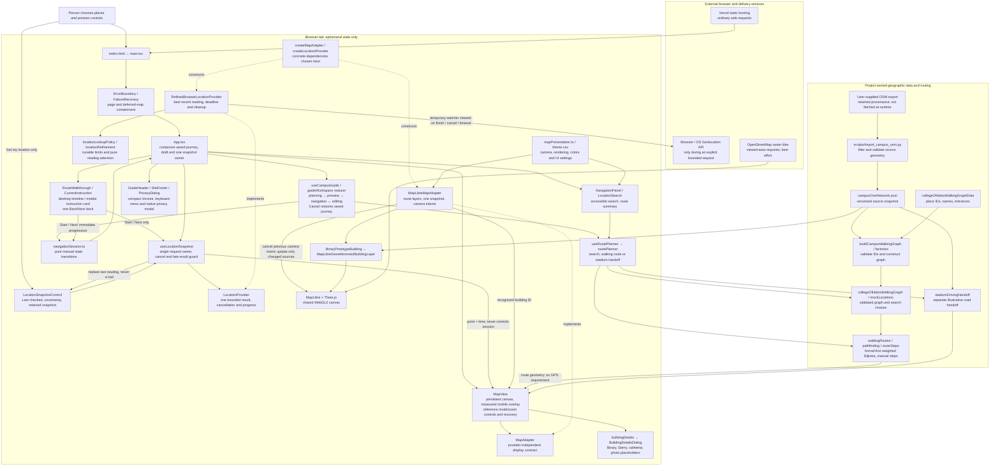
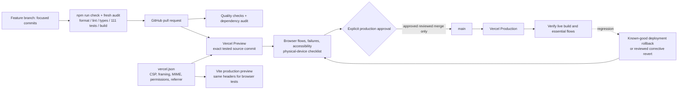

# Yotes Wayfinder architecture

This diagram describes the implemented manual campus guide. A solid arrow means
data or control flows between modules; dotted arrows mark implementation or
verification relationships. It is not a proposal for live navigation.

## Application, data and privacy boundaries

The two independent lanes are essential. The illustrated session can advance
without location permission or physical movement. A real snapshot is requested
only by Get my location, Start navigating or Next. Back, page load, elapsed time
and mode changes never request location. One hook owns cancellation; late results
cannot overwrite a different route. The tab retains only the most recent reading,
with no application storage, history upload or analytics service.

The map draws results; it does not choose routes or verify arrival. The current
OSM-derived graph is the accepted baseline, with inferred connections and
unverified access honestly identified. Future exports enter through the importer
and tests, not through a replacement UI or backend. The library mesh is visual
only, with illustrative height; other realistic 3D work is not part of this release.

## Verification and release boundary

A Content Security Policy (CSP) restricts which resources the browser may execute
or load. Scripts and workers are same-origin; MapLibre requires inline style
attributes for placement, not inline scripts. The production preview uses the same
header configuration as Vercel. A passing local build, a pushed commit, a ready
preview and a verified production release remain separate claims.

Update both diagrams whenever module ownership, third-party requests or the
release boundary changes. The detailed handbook is [ARCHITECTURE.md](ARCHITECTURE.md).
