# Yotes Wayfinder Architecture Diagram

This is the maintained visual map of the project. Solid arrows and green or
gold boxes represent implemented behavior. Dashed arrows label contract
implementations, verification relationships, and deployment connections.
Update this diagram whenever a major module, data flow, external dependency, or
architectural boundary changes.

```mermaid
flowchart TB
    User([Person using Yotes Wayfinder])

    subgraph Browser[Browser application]
        Index[index.html<br/>HTML host]
        Main[src/main.tsx<br/>React entry]
        App[src/app/App.tsx<br/>screen composition and map mode]

        subgraph NavigationUI[Navigation feature]
            Panel[NavigationPanel.tsx<br/>inputs, suggestions, route summary]
            PlannerHook[useRoutePlanner.ts<br/>shared planner state]
            PlannerModel[routePlanner.ts<br/>search and route outcomes]
            LocationContract[LocationProvider.ts<br/>single-result request, optional progress and cancel]
            ScenarioContract[PrototypeLocationScenario.ts<br/>optional test-result capability]
            NavigationControls[CheckpointNavigation.tsx<br/>Start navigation, Next Turn, recovery]
            CheckpointHook[useCheckpointNavigation.ts<br/>request guard and session state]
            BrowserProvider[BrowserLocationProvider.ts<br/>validated readings and typed failures]
        RefinedProvider[RefinedBrowserLocationProvider.ts<br/>bounded lookup, progress and cleanup]
        ReadingSelection[locationRefinement.ts and locationLookupPolicy.ts<br/>best recent reading and labeled tuning]
            PrototypeProvider[PrototypeLocationProvider.ts<br/>selectable checkpoint simulation]
        end

        subgraph NavigationDomain[Provider-independent navigation domain]
            WalkingRoutes[walkingRoutes.ts<br/>path-to-route conversion]
            Pathfinder[pathfinding.ts<br/>formal-first weighted Dijkstra]
            RouteSteps[routeSteps.ts<br/>maneuvers, nearby-turn merging, checkpoints]
            LocationVerification[locationVerification.ts<br/>distance and accuracy classification]
            NavigationSession[navigationSession.ts<br/>explicit progress state machine]
            DomainTypes[types.ts<br/>locations, routes, graph contracts]
            Factories[factories.ts<br/>validation and immutability]
        end

        subgraph MapFeature[Map feature]
            MapView[MapView.tsx<br/>React lifecycle and controls]
            MapContract[MapAdapter.ts<br/>provider-neutral contract]
            BuildingContract[GeoreferencedBuilding.ts<br/>owned building description]
            Adapter[MapLibreMapAdapter.ts<br/>map lifecycle and overlays]
            BuildingLayer[MapLibreGeoreferencedBuildingLayer.ts<br/>one library footprint in 3D]
        end

        subgraph Rendering[Rendering libraries]
            MapLibre[MapLibre GL JS<br/>projection, camera, basemap, overlays]
            Three[Three.js<br/>footprint extrusion in shared map canvas]
            GPU[(WebGL / device GPU)]
        end
    end

    subgraph Composition[Application composition boundary]
        CreateAdapter[createMapAdapter.ts<br/>constructs concrete integrations]
        CreateLocation[createLocationProvider.ts<br/>selects route provider and makes real locate provider]
    end

    subgraph OwnedData[Project-owned data]
        GraphData[collegeOfIdahoWalkingGraphData.ts<br/>50 curated destinations, entrances and courts,<br/>illustrative provenance]
        Snapshot[campusOsmNetwork.json<br/>walking ways, selected roads,<br/>sport/building outlines and entrances]
        StadiumHandoff[stadiumDrivingHandoff.ts<br/>limited prototype road handoff]
        GraphBuilder[buildCampusWalkingGraph.ts<br/>validates IDs, projects outline connectors]
        GraphLoader[collegeOfIdahoWalkingGraph.ts<br/>validated runtime release]
        Locations[mockLocations.ts<br/>searchable locations derived from graph]
        Campus[collegeOfIdahoCampus.ts<br/>campus overview and pan boundary]
        CampusPresence[classifyCampusLocation.ts<br/>approximate campus-area check]
        LibraryScene[libraryPrototypeBuilding.ts<br/>OSM library outline, illustrative height]
    end

    subgraph ExternalRuntime[External runtime and hosting]
        OSM[OpenStreetMap raster tiles<br/>prototype basemap]
        BrowserGPS[Browser Geolocation API<br/>one-shot checkpoints and bounded lookup]
        Vercel[Vercel static hosting<br/>production prototype]
    end

    subgraph QualityAndKnowledge[Development quality and project knowledge]
        Tests[Vitest and Testing Library<br/>focused automated tests]
        Tooling[TypeScript, ESLint, Prettier, Vite<br/>strict checks, no production source maps,<br/>copyright banner and dependency notices]
        VercelConfig[vercel.json<br/>Vite preset, checked build, dist output]
        GitHub[GitHub main<br/>approved source commits]
        FeatureBranch[Feature branch and pull request<br/>isolated development and preview review]
        Quality[.github/workflows/quality.yml<br/>locked install and existing quality commands]
        ReleaseGuide[docs/RELEASE_WORKFLOW.md<br/>review, release, verification and recovery]
        Theme[src/styles/theme.css<br/>named interface colors, fonts and layout values]
        MapPresentation[mapPresentation.ts<br/>typed camera and route colors]
        BuildingDetails[buildingDetails.ts<br/>three OSM footprints, descriptions and photo slots]
        BuildingDialog[BuildingDetailsDialog and BuildingPhotoCarousel<br/>modal details and manual image slides]
        Handbook[README and docs<br/>architecture, progress, skills, decisions]
        OSMExport[User-supplied OSM XML snapshot<br/>reviewed source geometry]
        Importer[scripts/import_campus_osm.py<br/>filtered, reproducible source import]
        Context7[Context7 MCP<br/>current library documentation]
        AgentRules[AGENTS.md<br/>approval and engineering rules]
    end

    User --> Index --> Main --> App
    App --> Panel
    App --> MapView
    NavigationControls --> App
    App -->|navigation session| MapView
    Panel --> PlannerHook --> PlannerModel --> WalkingRoutes
    PlannerHook --> GraphLoader
    PlannerHook --> Locations
    PlannerModel --> StadiumHandoff
    WalkingRoutes --> Pathfinder
    WalkingRoutes --> RouteSteps
    WalkingRoutes --> Factories
    RouteSteps --> DomainTypes
    NavigationSession --> RouteSteps
    NavigationSession --> LocationVerification
    LocationVerification --> DomainTypes
    LocationContract --> DomainTypes
    Pathfinder --> DomainTypes
    Factories --> DomainTypes
    GraphLoader --> GraphData
    GraphData --> GraphBuilder
    GraphBuilder --> Snapshot
    StadiumHandoff --> Snapshot
    GraphLoader --> Factories
    Locations --> GraphData
    Locations --> Factories
    WalkingRoutes --> MapView
    App -->|separate driving handoff| MapView

    MapView --> MapContract --> CreateAdapter --> Adapter
    MapView --> CampusPresence --> Campus
    MapView -->|short user-triggered lookup| RefinedProvider
    RefinedProvider --> ReadingSelection
    RefinedProvider --> BrowserGPS
    MapView -->|blue dot and closer camera| MapContract
    Adapter -->|overview, preview fit, leg colors and turn camera| MapLibre
    Campus --> MapView
    Snapshot --> LibraryScene
    LibraryScene --> BuildingContract --> BuildingLayer
    CreateAdapter --> BuildingLayer
    Adapter --> MapLibre
    Adapter --> BuildingLayer --> Three
    MapLibre --> GPU
    Three --> GPU
    OSM --> MapLibre
    GitHub --> VercelConfig
    FeatureBranch --> Quality
    Theme --> App
    MapPresentation --> Adapter
    BuildingDetails --> CreateAdapter
    BuildingDetails --> MapView
    Adapter -->|recognized building ID callback| MapView
    MapView --> BuildingDialog
    Theme --> BuildingDialog
    FeatureBranch -. separate test deployment .-> Vercel
    ReleaseGuide -. governs release .-> FeatureBranch
    FeatureBranch -. reviewed merge .-> GitHub
    GitHub --> Quality
    VercelConfig -. builds dist .-> Vercel
    Vercel -. serves prototype .-> Index
    OSMExport --> Importer --> Snapshot
    OSMExport -. counts and gaps .-> Handbook

    Tests -. verify .-> NavigationDomain
    Tests -. verify .-> MapFeature
    Tooling -. checks and bundles .-> Browser
    Handbook -. explains .-> Browser
    AgentRules -. governs changes .-> QualityAndKnowledge
    Context7 -. current dependency docs .-> QualityAndKnowledge

    App --> CreateLocation
    CreateLocation --> PrototypeProvider
    CreateLocation --> BrowserProvider
    CreateLocation --> RefinedProvider
    App -->|optional simulator capability| Panel
    Panel --> NavigationControls --> CheckpointHook
    NavigationControls --> ScenarioContract
    PrototypeProvider -. implements .-> ScenarioContract
    CheckpointHook --> LocationContract
    BrowserProvider -. implements .-> LocationContract
    PrototypeProvider -. implements .-> LocationContract
    BrowserProvider --> BrowserGPS
    CheckpointHook --> NavigationSession
    NavigationSession --> NavigationControls

    classDef implemented fill:#dff3e7,stroke:#155f3a,color:#082f20,stroke-width:2px
    classDef integration fill:#fff0c2,stroke:#9b6500,color:#493000,stroke-width:2px
    classDef external fill:#e9f0ff,stroke:#315da8,color:#172f58,stroke-width:2px
    classDef dormant fill:#eeeeee,stroke:#777,color:#333,stroke-dasharray:6 4

    class Index,Main,App,Panel,PlannerHook,PlannerModel,LocationContract,WalkingRoutes,Pathfinder,RouteSteps,LocationVerification,NavigationSession,DomainTypes,Factories,MapView,MapContract,CampusPresence,GraphData,GraphBuilder,Snapshot,StadiumHandoff,GraphLoader,Locations,Campus,LibraryScene,BuildingContract implemented
    class CreateAdapter,Adapter,MapLibre,BuildingLayer,Three,GPU integration
    class OSM,OSMExport,Importer,Tests,Tooling,Handbook,Context7,AgentRules,GitHub external
    class VercelConfig implemented
    class Vercel external
    class NavigationControls,CheckpointHook implemented
    class CreateLocation,BrowserProvider,PrototypeProvider integration
    class BrowserGPS external
```

## How to read the diagram

- The navigation domain has no dependency on MapLibre or Three.js. It can be
  tested and changed without starting a map.
- `MapAdapter` is the boundary used by React. `createMapAdapter.ts` selects
  MapLibre and attaches one footprint-based library layer. The former
  inaccurate Hendren block remains removed. Three.js is isolated in the
  custom layer; the rest of React does not construct 3D objects.
- The walking graph is the routing authority. Future 3D content cannot define
  an entrance or a safe walking path by itself.
- The user-supplied OSM XML is a reviewed source, not a runtime map service.
  The import script creates committed connected walking geometry; the graph
  builder combines it with 50 curated places. The user identified separate
  Simplot and JAAC/pool entrances and Anderson's resident-used door. Unmapped
  area/entrance connectors and access facts remain illustrative.
- Beach Volleyball Court 2 now resolves to an OSM-tagged main gate on its own
  outline. The other seven courts still use provisional outline approaches;
  all gate-to-walkway connectors need field confirmation.
- The app opens with empty search fields and a tilted campus-and-stadium
  overview. Previewing a route fits its path with a small margin. The one
  library mesh uses its OSM footprint and an illustrative height; 2D hides it
  and keeps a milder tilt while preserving route state.
- Simplot Stadium is the exception to walking guidance: the planner returns a
  separate prototype road handoff from a mapped campus driveway to a parking
  approach. The dashed MapLibre line does not create a driving checkpoint
  session or a route from the selected origin. Driveway permission is unverified.
- `routeSteps.ts` is implemented domain logic. It converts selected edge
  geometry into maneuvers and checkpoints. The implemented navigation session
  consumes those checkpoints without depending on a browser location API.
- Location verification, session transitions, the browser provider, and visible
  navigation controls are connected. Requests happen only on explicit navigation
  clicks; route revisions reset the session and discard late results.
- Composition selects the prototype simulator by default. It uses the expected
  checkpoint supplied through the contract; `VITE_LOCATION_MODE=browser` selects
  physical one-shot browser location for future field testing.
- The prototype provider offers a scenario capability used in testing. The
  ordinary interface uses expected checkpoint readings; its former scenario
  menu is hidden. A changed route starts a fresh component session.
- The navigation component reports immutable session progress to App. App passes
  it to MapView, and the adapter converts it into completed/current/upcoming leg
  styling and a camera focused along the current travel direction. On a narrow
  screen, route preview scrolls to the map, but turn updates do not displace
  written instructions.
- MapLibre owns the camera and browser rendering. The attached Three.js layer
  renders one library footprint with an illustrative height in 3D mode.

## Diagram maintenance checklist

Update this file in the same commit when a change:

1. Adds, removes, or renames a major runtime module.
2. Changes which module owns state or data.
3. Adds or removes a third-party runtime service.
4. Adds a new implemented component.
5. Changes the direction of an important dependency.
6. Introduces a new verification, documentation, or build system that affects
   the project workflow.
